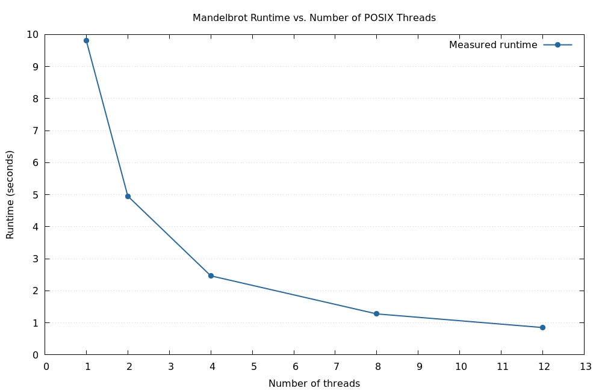
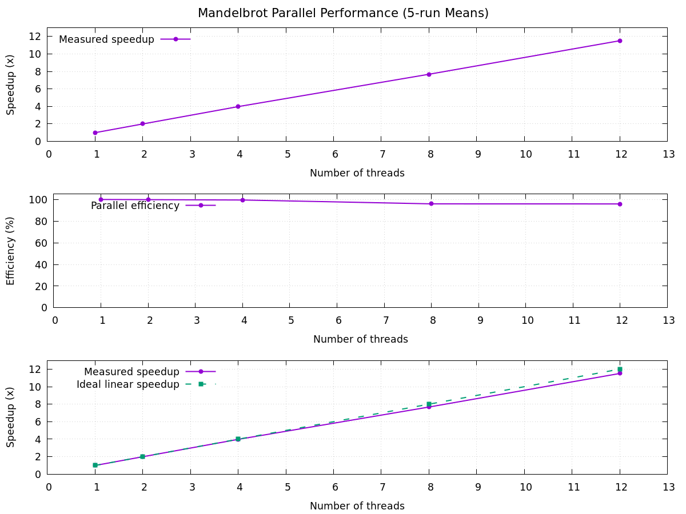

# Assignment 04

## Exercise 1




## Exercise 2

Remarks:
- 8-way associative cache: divides the cache memory into sets where each set contains 8 cache lines
    - lower conflict misses because it is flexible in where a mem block can live

### Function for data cache read misses

Let `s` be the cache-line size in bytes and let

`q = s / sizeof(int32_t) = s / 4`

be the number of matrix elements per cache line. Ignoring compulsory misses
from initialization and counting the two input matrices, the row-major
implementation has

`f_row(n, s) = 2 n^2 / q = 8 n^2 / s`

data-cache read misses. Each input line is used for `q` consecutive products.
The column-major implementation has

`f_column(n, s) = 2 n^2`

data-cache read misses when the matrix is much larger than the cache: successive
accesses in a column are `n` elements apart, so every input element is on a
different line from the next access. These formulas assume `s` is a multiple
of four, the matrices are aligned independently, and cache capacity/conflict
effects do not preserve a line until its next use.

### Cache behaviour of the implementations

For `n = 1024`, a 64-byte cache line contains
`q = 64 / sizeof(int32_t) = 16` matrix elements. Therefore, the
theoretical number of input-matrix L1 data read misses is

```text
row-major:    2n² / q = 131,072
column-major: 2n²     = 2,097,152
```

The implementations were measured separately with Cachegrind using a
32 KiB, 8-way associative L1 data cache with 64-byte cache lines representing the L1 Data and Instruction cache of LCC3.

#### Results

| Implementation | L1 data read misses (`D1mr`) | Theoretical value | L1 read miss rate |
|---|---:|---:|---:|
| Row-major | 133,828 | 131,072 | 12.1% |
| Column-major | 2,099,932 | 2,097,152 | 97.3% |

The measured ratio is approximately `15.7:1`, close to the predicted
`16:1`.

*GPT-5.6 Luna*: The small difference is caused by additional accesses from
initialization, address calculations, and runtime setup, which are not
included in the theoretical model.

row-major impl accesses consecutive elements in each row.
col-major impl access elements that are 1024 positions apart in mem which is way larger than one cache line, resulting in a lot of misses.

The measured last-level-cache read misses were similar (`2,313` for
row-major and `2,802` for column-major). The simulation used a 24-way
associative LLC, whereas the node has a 16-way associative LLC. This can
change conflict misses, so the exact LLC miss counts may differ on the node;
however, since the matrices fit in the LLC, the overall conclusion is
unlikely to change. The important difference between the implementations
appears at the L1 data cache, as predicted.

#### Hardware counters with `perf`

The two modes were also measured separately with `perf stat` for
`n = 1024`:

| Implementation | L1 loads | L1 load misses | L1 stores | L1 store misses | LLC load misses | LLC store misses |
|---|---:|---:|---:|---:|---:|---:|
| Row-major | 1,645,097 | 389,460 | 2,618,535 | 193,948 | 674 | 173 |
| Column-major | 2,123,201 | 3,512,887 | 3,378,261 | 1,178,946 | 840,825 | 414,600 |

The hardware results confirm the expected cache behaviour: column-major
traversal produces substantially more L1 and LLC misses than row-major
traversal. In particular, the column-major run has about `9.0` times as
many reported L1 load misses and about `1,249` times as many LLC load
misses. Its reported elapsed time is also lower in this particular run,
so timing should not be used as evidence here; the counters are the
relevant measurements.

The `perf` results are not numerically identical to Cachegrind. Hardware
counters include prefetching, speculation, operating-system activity, and
counter multiplexing. The percentages in the log show that the events
were multiplexed, and the column-major L1 load-miss percentage is above
100%, so those scaled percentages should not be interpreted literally.
The raw counts still support the theoretical conclusion that row-major
access is much more cache-friendly.
